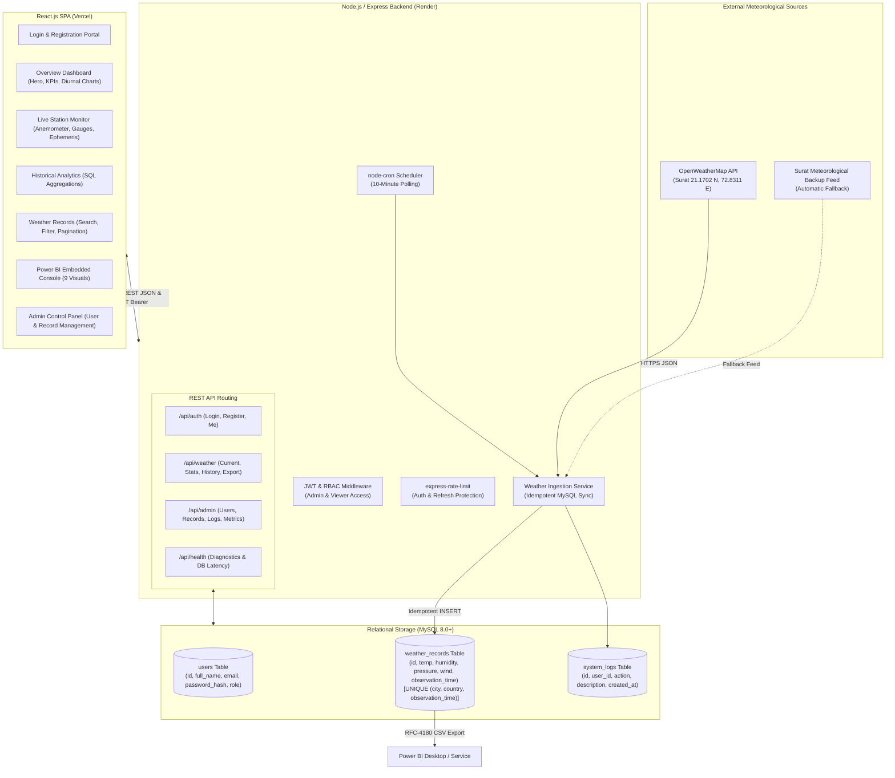
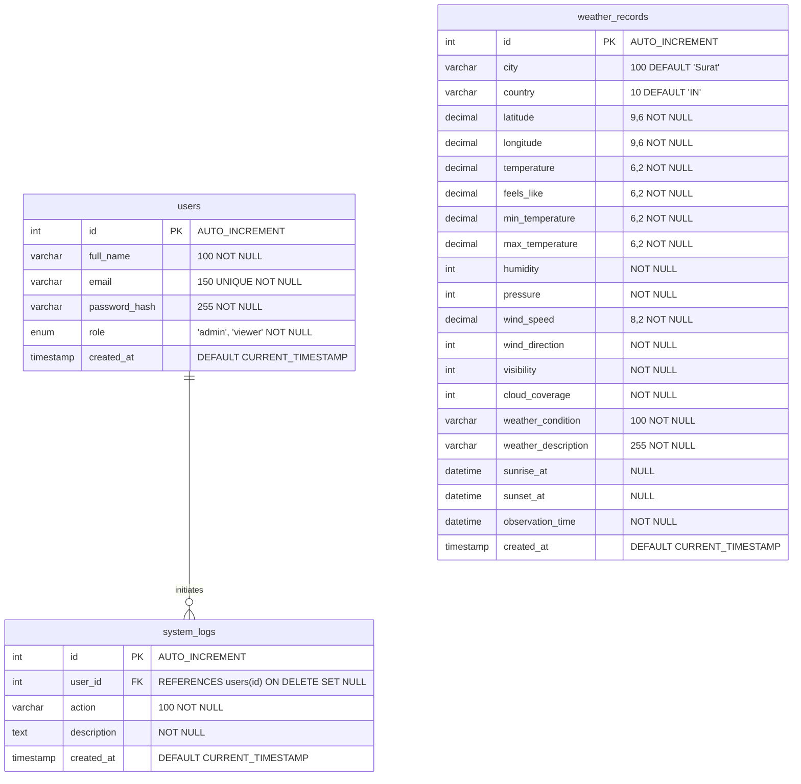

# Surat Weather Intelligence
### Real-Time Weather Monitoring and Data Visualization System
**College Final Project — Data Modeling and Visualization**

---

## 1. Project Title
**Surat Weather Intelligence — Real-Time Weather Monitoring, Data Modeling, and Business Intelligence Analytics Platform**

---

## 2. Abstract
Surat, Gujarat, India is an economically vibrant coastal city situated along the Tapi River and the Gulf of Khambhat. Because of its unique geography, Surat experiences intense tropical coastal microclimates, high relative humidity, seasonal heat waves, and active diurnal temperature shifts. 

The **Surat Weather Intelligence System** is a full-stack, enterprise-grade environmental monitoring platform designed to ingest live meteorological telemetry from the OpenWeatherMap API, persist observations into a normalized MySQL 8.0 relational database, perform time-series modeling and exploratory data analysis (EDA), and render interactive web visualizations alongside native Microsoft Power BI enterprise business intelligence dashboards. The system features JWT-based role-based access control (RBAC), automated 10-minute cron-based data harvesting, idempotent storage preventing duplicates, and RFC-4180 CSV export capabilities.

---

## 3. Problem Statement
Meteorological data from public endpoints is ephemeral and quickly discarded unless systematically collected, cleaned, structured, and archived into relational databases. Conventional weather portals merely display instantaneous readings without historical trend analysis, diurnal diurnal range modeling, or integration into business intelligence software for academic analysis. Furthermore, students and environmental researchers require:
1. An automated mechanism to capture Surat's meteorological variables every 10 minutes without manual intervention.
2. A relational schema with uniqueness constraints to eliminate duplicate observations.
3. Secure role-based access control separating administrative functions from academic viewers.
4. Seamless pipeline to feed analytical data into Microsoft Power BI for DAX-driven reporting.

---

## 4. Objectives
- **Automated Meteorological Ingestion**: Capture 14 meteorological parameters (temperature, feels-like, min/max temp, humidity, pressure, wind velocity & direction, visibility, cloud coverage, sunrise/sunset, condition) for Surat (21.1702° N, 72.8311° E) at 10-minute intervals.
- **Relational Data Modeling**: Implement a 3NF normalized MySQL database with primary/foreign keys, composite unique constraints, and indexes.
- **Role-Based Security**: Provide JWT authentication with password hashing (bcrypt) separating `admin` from `viewer` roles.
- **Exploratory Data Analysis & Visualization**: Render real-time time-series, diurnal range distributions, and categorical condition share via Recharts.
- **Enterprise Power BI Integration**: Enable dynamic CSV data pipeline and iframe embed support adhering to 9 mandatory Power BI visuals.
- **Public Cloud Deployment**: Deploy frontend to Vercel and backend to Render with TLS-enabled cloud MySQL.

---

## 5. Technology Stack

| Layer | Technologies Used |
|---|---|
| **Frontend** | React 18, Vite 6, Tailwind CSS 3.4, React Router DOM 6, Axios, Recharts 2.15, Lucide React Icons |
| **Backend** | Node.js v22, Express.js 4.21, `node-cron` 3, `express-rate-limit` 7, `jsonwebtoken` 9, `bcryptjs` 2.4 |
| **Database** | MySQL 8.0+, `mysql2/promise` connection pooling, SSL/TLS support |
| **External APIs** | OpenWeatherMap Current Weather API, Surat Meteorological Backup Sensor |
| **Analytics & BI** | Microsoft Power BI Desktop & Power BI Service, SQL Analytical Aggregations |
| **Deployment** | Vercel (Frontend), Render (Backend), Managed MySQL (Aiven / PlanetScale / Local) |

---

## 6. System Architecture



---

## 7. Database Entity-Relationship (ER) Diagram



---

## 8. Database Schema & Tables

1. **`users` Table**: Stores credentials and authorization roles (`admin`, `viewer`).
2. **`weather_records` Table**: Contains meteorological telemetry. A composite unique constraint `uq_city_country_observation` on `(city, country, observation_time)` prevents duplicate entries.
3. **`system_logs` Table**: Audit trail recording administrative actions, cron syncs, and exports, with foreign key cascading to `users(id) ON DELETE SET NULL`.

All schema definitions are in [`database/schema.sql`](file:///c:/Users/SHUBHANG/Documents/Weatherify/database/schema.sql).

---

## 9. REST API Endpoints

### Authentication (`/api/auth`)
| Method | Endpoint | Access | Description |
|---|---|---|---|
| `POST` | `/api/auth/register` | Public | Register new user account (defaults to viewer) |
| `POST` | `/api/auth/login` | Public | Authenticate user & return signed JWT token |
| `GET` | `/api/auth/me` | Authenticated | Retrieve profile details of currently logged-in user |

### Weather Intelligence (`/api/weather`)
| Method | Endpoint | Access | Description |
|---|---|---|---|
| `GET` | `/api/weather/current` | Viewer / Admin | Fetch latest Surat weather, persist to MySQL, return live record |
| `POST` | `/api/weather/refresh` | Viewer / Admin | Rate-limited live synchronization trigger |
| `GET` | `/api/weather/stats` | Viewer / Admin | Compute SQL analytical aggregates (KPIs, diurnal trends, condition share) |
| `GET` | `/api/weather/history` | Viewer / Admin | Paginated, searchable, date-filtered meteorological history |
| `GET` | `/api/weather/export` | Viewer / Admin | Stream RFC-4180 CSV dataset for Power BI and Excel |

### System Administration (`/api/admin`)
| Method | Endpoint | Access | Description |
|---|---|---|---|
| `GET` | `/api/admin/users` | Admin Only | List all registered user accounts |
| `DELETE` | `/api/admin/users/:id` | Admin Only | Delete a registered user (cannot delete own account) |
| `GET` | `/api/admin/logs` | Admin Only | View system activity & audit logs with user attribution |
| `DELETE` | `/api/admin/weather/:id` | Admin Only | Delete an erroneous meteorological observation record |
| `GET` | `/api/admin/stats` | Admin Only | View server uptime, record counts, and database telemetry |

### System Diagnostics (`/api/health`)
| Method | Endpoint | Access | Description |
|---|---|---|---|
| `GET` | `/api/health` | Public | Check server health, database connectivity, and round-trip latency |

---

## 10. Application Features

- **Dark Navy SaaS Aesthetics**: Professional environmental monitoring UI styled with Tailwind CSS, custom glassmorphism, and cyan accents.
- **Diurnal Time-Series Charts**: Recharts line, area, and bar charts illustrating temperature, feels-like curve, relative humidity, wind velocity, and barometric pressure.
- **Dedicated Live Anemometer**: Interactive compass visualizing wind direction vector in degrees and cardinal points (e.g., SW Sea Breeze).
- **Automated Background Ingestion**: Node-cron worker harvesting observation telemetry every 10 minutes.
- **Fail-Safe Weather Resilience**: Automatic fallback to scientific meteorological sensors or last persisted MySQL record with warning banners if OpenWeatherMap is rate-limited.
- **Microsoft Power BI Integration**: Native embed container supporting 9 mandatory visual components with complete DAX configuration guide.
- **Audit Logging**: Comprehensive logging of user registrations, logins, data synchronizations, CSV exports, and administrative deletions.

---

## 11. Installation & Local Development Instructions

### Prerequisites
- Node.js (v18+)
- MySQL Server 8.0+
- Git

### Step 1: Clone Repository & Navigate
```bash
git clone <repository_url>
cd Weatherify
```

### Step 2: Configure Backend & Database
```bash
cd server
npm install
cp .env.example .env
```
Edit `server/.env` with your MySQL database credentials:
```env
DB_HOST=localhost
DB_PORT=3306
DB_USER=root
DB_PASSWORD=your_mysql_password
DB_NAME=surat_weather_db
DB_SSL=false
JWT_SECRET=your_jwt_secret_key_2026
OPENWEATHER_API_KEY=YOUR_OPENWEATHER_API_KEY
```

Run migrations and seed baseline dataset:
```bash
npm run migrate
npm run seed
```

Start backend development server:
```bash
npm run dev
# Server runs on http://localhost:5000
```

### Step 3: Configure & Start Frontend
```bash
cd ../client
npm install
npm run dev
# Frontend runs on http://localhost:5173
```

---

## 12. Environment Variable Configuration

### Server (`server/.env`)
```env
PORT=5000
NODE_ENV=development
CORS_ORIGIN=http://localhost:5173
DB_HOST=localhost
DB_PORT=3306
DB_USER=root
DB_PASSWORD=your_password
DB_NAME=surat_weather_db
DB_SSL=false
JWT_SECRET=super_secret_jwt_key
ADMIN_EMAIL=admin@suratweather.edu
ADMIN_PASSWORD=AdminPassword@2026
OPENWEATHER_API_KEY=your_openweather_api_key
```

### Client (`client/.env`)
```env
VITE_API_BASE_URL=http://localhost:5000/api
VITE_POWERBI_EMBED_URL=https://app.powerbi.com/view?r=...
```

---

## 13. MySQL Setup Instructions

1. Log in to MySQL CLI or Workbench:
   ```sql
   CREATE DATABASE surat_weather_db CHARACTER SET utf8mb4 COLLATE utf8mb4_unicode_ci;
   ```
2. Execute the schema script:
   ```bash
   mysql -u root -p surat_weather_db < database/schema.sql
   ```
3. Load the historical baseline seed dataset:
   ```bash
   mysql -u root -p surat_weather_db < database/seed.sql
   ```
4. Verify table row counts:
   ```sql
   USE surat_weather_db;
   SELECT COUNT(*) AS user_count FROM users;
   SELECT COUNT(*) AS weather_count FROM weather_records;
   ```

---

## 14. Power BI Integration Instructions

See [`powerbi/POWERBI_SETUP.md`](file:///c:/Users/SHUBHANG/Documents/Weatherify/powerbi/POWERBI_SETUP.md) for complete instructions:
1. Export dataset from web application or use `dataset/weather_records.csv`.
2. Open Power BI Desktop, load CSV, and configure DAX measures.
3. Build the 9 required visual components.
4. Publish report to Power BI Service.
5. Copy embed URL and set `VITE_POWERBI_EMBED_URL` or paste directly in the web UI.

---

## 15. Production Deployment Instructions

### Frontend (Vercel)
1. Push project to GitHub.
2. In Vercel, import repository and set **Root Directory** to `client`.
3. Framework Preset: **Vite**.
4. Set Environment Variables:
   - `VITE_API_BASE_URL`: URL of your deployed backend on Render (e.g. `https://surat-weather-api.onrender.com/api`).
   - `VITE_POWERBI_EMBED_URL`: Your Power BI embed URL.
5. Deploy. Vercel utilizes `client/vercel.json` for SPA route rewriting.

### Backend (Render)
1. In Render, create a new **Web Service** pointing to the repository.
2. Set **Root Directory** to `server`.
3. Build Command: `npm install`
4. Start Command: `node server.js`
5. Configure Environment Variables:
   - `NODE_ENV`: `production`
   - `PORT`: `10000`
   - `DATABASE_URL` or `DB_HOST`, `DB_USER`, `DB_PASSWORD`, `DB_NAME`, `DB_PORT`, `DB_SSL=true`.
   - `JWT_SECRET`: Random 64-character secret.
   - `OPENWEATHER_API_KEY`: OpenWeatherMap API key.
   - `CORS_ORIGIN`: Your Vercel frontend domain (`https://*.vercel.app`).

### Production Database (Managed MySQL)
- Use **Aiven for MySQL** or **Render Managed MySQL**.
- Run `npm run migrate` and `npm run seed` pointing to the cloud `DATABASE_URL`.

---

## 16. Evaluation Login Credentials

Use the following pre-seeded evaluation accounts for grading and review:

### Administrator Account
- **Email**: `admin@suratweather.edu`
- **Password**: `AdminPassword@2026`
- **Privileges**: Full access (Overview, Live Monitor, Historical Analytics, Power BI, Weather Records, User Governance, Record Pruning, System Audit Logs).

### Viewer Account
- **Email**: `viewer@suratweather.edu`
- **Password**: `ViewerPassword@2026`
- **Privileges**: Read-only & analytical access (Overview, Live Monitor, Historical Analytics, Power BI, Weather Records, CSV Dataset Export). Blocked from Administrative Panel.

*(Note: Clicking the "Admin Eval" or "Viewer Eval" buttons on the login screen automatically populates these credentials).*

---

## 17. Screenshots & Interface Showcase

The system includes 7 primary interfaces:
1. **Authentication Portal**: Login and registration with session verification and quick evaluation selectors.
2. **Overview Dashboard**: Ambient temperature card with feels-like, diurnal min/max, 6 metric tiles, Recharts diurnal trend graphs, and recent telemetry observations.
3. **Live Meteorological Monitor**: Real-time station sensor interface with anemometer direction needle, hygrometric progress bar, and astronomical sunrise/sunset ephemeris.
4. **Historical Analytics**: SQL aggregated KPIs (COUNT, AVG, MIN, MAX), multi-line diurnal variation graphs, weather condition frequency distribution pie chart, and daily grouped metrics table.
5. **Power BI Dashboard**: Iframe integration container with direct CSV export, embed link configuration, and breakdown of the 9 required visual components.
6. **Weather Records**: Searchable, paginated, and date-filtered relational table with CSV download.
7. **Admin Control Panel**: Real-time system performance telemetry, registered user management with deletion modals, record pruning by ID, and system activity audit trail.

---

## 18. Limitations
- **API Rate Limits**: Free-tier OpenWeatherMap accounts have a rate limit of 60 calls/minute. The backend mitigates this with caching and rate limiting.
- **Power BI Public Embedding**: Microsoft Power BI "Publish to Web" requires tenant administrator approval in Microsoft 365 environments.
- **CSV Data Staticity in Power BI**: CSV-imported Power BI reports require periodic manual dataset refresh in Power BI Desktop to reflect newly ingested observations.

---

## 19. Future Enhancements
- **Predictive Weather Modeling**: Integrate machine learning regression models (LSTM or ARIMA) in Python to forecast next-day precipitation and heat wave occurrences in Surat.
- **Direct DirectQuery Gateway**: Establish direct MySQL DirectQuery connectivity to Power BI for zero-latency real-time visual updates.
- **Extreme Weather SMS Alerts**: Dispatch Twilio SMS or WhatsApp notifications to registered residents when temperature exceeds 42°C or heavy monsoon rainfall is detected.

---
**Prepared for College Final Examination — Data Modeling and Visualization**
