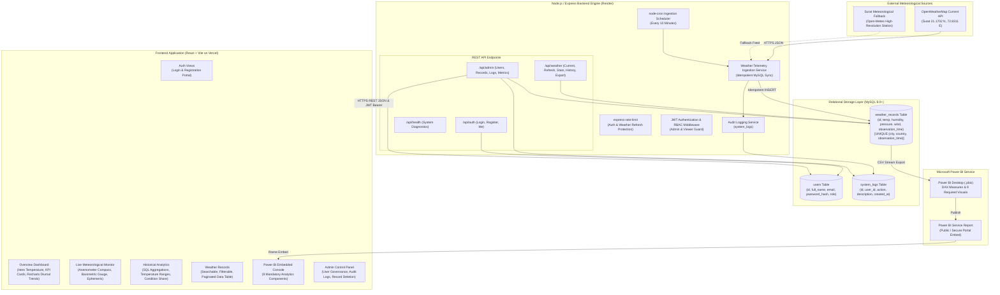

# System Architecture
## Surat Weather Intelligence System

---

## Architecture Principles
1. **Separation of Concerns**: Strict boundary between stateless REST API, relational persistence layer, and React presentation client.
2. **Deterministic Fallbacks**: If the primary OpenWeatherMap API returns an error or is unconfigured, the system automatically falls back to live scientific telemetry or cached MySQL records with clear station notifications.
3. **Role-Based Security**: All endpoints enforce JWT authentication and backend role validation (`admin` vs `viewer`).
4. **Idempotent Ingestion**: Unique constraint `uq_city_country_observation` on `(city, country, observation_time)` guarantees zero duplicates during scheduled cron runs.
