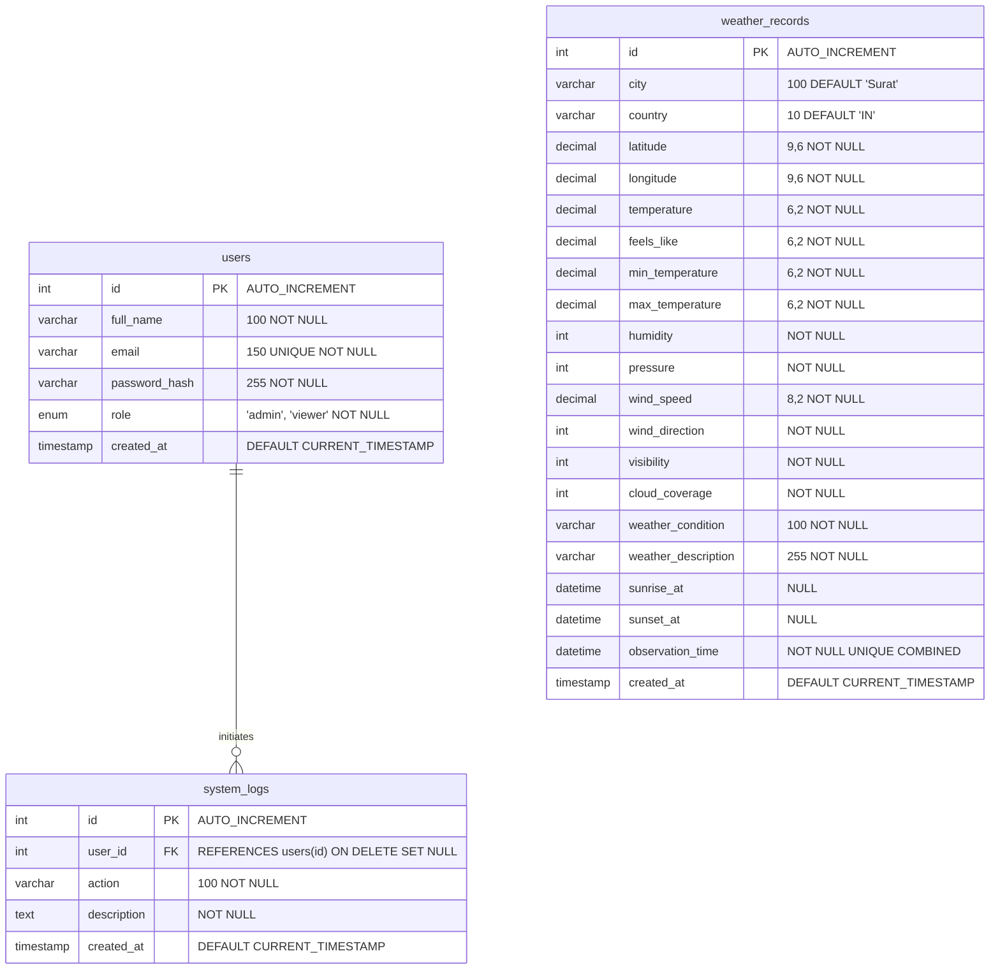

# Relational Database Design
## Surat Weather Intelligence System — MySQL 8.0+

---

## Relational Constraints & Indexing Strategy

### 1. `users` Table
- **Primary Key**: `id`
- **Unique Key**: `email`
- **Indexes**: `idx_users_email` (Fast lookup on login), `idx_users_role` (Authorization filtering).

### 2. `weather_records` Table
- **Primary Key**: `id`
- **Composite Unique Key**: `uq_city_country_observation` on `(city, country, observation_time)`. Prevents duplicate observations when automated ingestion executes or when users refresh.
- **Indexes**:
  - `idx_observation_time`: High-speed time-series queries and date range filtering.
  - `idx_weather_condition`: Rapid categorical aggregations.
  - `idx_created_at`: Audit and telemetry ingestion tracking.

### 3. `system_logs` Table
- **Primary Key**: `id`
- **Foreign Key**: `fk_system_logs_user` pointing to `users(id)` with `ON DELETE SET NULL ON UPDATE CASCADE`. Ensures system audit history is preserved even if a user account is deleted by an administrator.
- **Indexes**: `idx_logs_action`, `idx_logs_created_at`.
